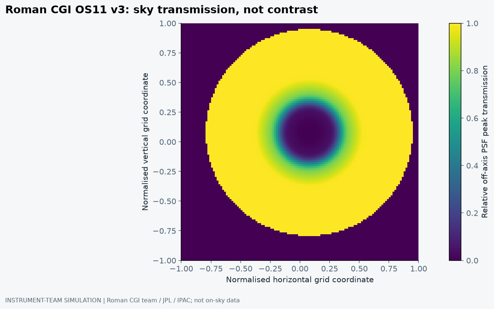
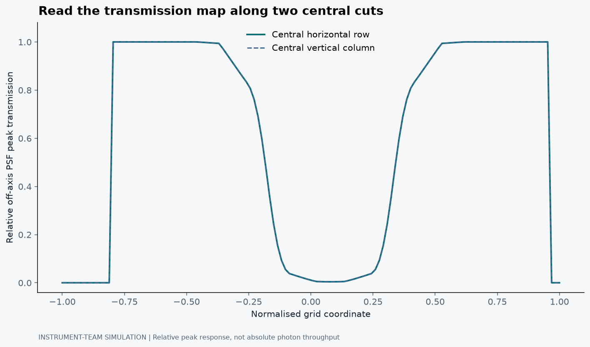

## The star is not politely staying out of the picture

Finding a faint planet beside a bright star is not simply a matter of taking a sharper photograph. The star contributes light across the image through diffraction and imperfect optics. The planet is much fainter, close to that bright structure, and not especially interested in making our observing proposal easier.

A coronagraph tries to suppress the star while leaving useful light from an off-axis companion. That final condition is important. If I block everything, the image becomes wonderfully dark and scientifically useless. Direct imaging needs both starlight rejection and a path through which the planet's signal survives.

My Coronagraph Dark Hole Lab started as a way to explore control ideas. Its primary public data route now uses an official Roman CGI observing-scenario simulation product, with a separate reduced-order control model. Keeping those layers distinct is the most important part of explaining the project (Jana, 2026).

## Darkness and throughput are different measurements

Contrast usually compares some measure of residual stellar light with a stellar reference, under a stated normalisation and measurement convention. Throughput describes how much of a source signal survives the optical system and extraction. Neither word has a complete meaning without saying what was measured and where.

A map of off-axis PSF peak transmission is therefore not an achieved contrast map. It tells us how the simulated system transmits an off-axis source under that product's definition. It does not give the residual stellar background, detector noise, integration time or a planet detection significance by itself.

The distinction sounds small until someone points to the darkest part of a throughput map and calls it the best place to find a planet. A dark region may instead mean that the system suppresses the companion's light there too. We need to know what the colour scale means before celebrating it.

## What the Roman product actually is

The project ingests the Roman CGI team's OS11 v3 Hybrid Lyot sky-transmission FITS product and retains source checksums and geometry. OS11 is a simulated flight-design observing scenario. It is not an image observed on the sky by Roman, and this post does not claim that it is (Roman CGI instrument team, n.d.).

The compact browser derivative contains a sampled grid of that product. The plot below uses those simulation values, with the instrument team's definition of the observable. It is separate from the conceptual cover illustration.

<figure><figcaption>Instrument-team simulation derivative, not an observation. Colour shows the Roman CGI OS11 v3 HLC sky-transmission grid supplied through the pinned project derivative. Coordinates are normalised grid indices, not a calibrated angular-separation axis. Credit: Roman CGI instrument team/JPL/IPAC. This is off-axis PSF peak transmission, not achieved contrast or detection probability.</figcaption></figure>

Read the colour bar first. A larger value means greater transmission under this map's normalisation. Structure across the field means the response depends on position. That can affect target placement and interpretation, but the plot alone cannot say whether a hypothetical planet would be detected.

I have not labelled the horizontal coordinate in λ/D because a reliable angular scale should come from verified product metadata. A familiar scientific unit is not an improvement if it has been attached without the required conversion.

## The light that leaks through still has a phase

Wavefront errors can create coherent speckles that resemble faint companions. A deformable mirror changes the optical field so that selected stellar leakage can interfere destructively in a controlled image region. The resulting dark hole is a deliberately controlled region, not a literal hole in the telescope image.

Give'on et al. (2007) describe a broadband wavefront-correction approach associated with electric field conjugation. Groff et al. (2016) discuss focal-plane sensing, estimation and control, including limitations. These methods involve more than choosing an exponential curve: they need an optical response model, field information and a constrained control calculation.

That matters because a simple simulator can be educational while being a poor forecast. If the code never propagates a complex pupil or constructs an interaction matrix, it should not imply that it has solved those parts of the problem off-screen.

## Why I kept the simpler model

The reduced model in the project separates entering leakage, convergence and a floor. It lets a reader ask what happens if the gain is zero, the initial error is larger, or the assumed control authority changes. Those are useful limiting-case checks.

But its coefficients are exploratory. It does not estimate a field from noisy probe images, propagate a real coronagraph, or solve the instrument's regularised inverse problem. The nominal deformable-mirror radius displayed by the workbench is not a guarantee of throughput or corrected area (Jana, 2026).

I would use that layer to explain why a control curve can flatten even when iterations continue. I would not use its final numerical contrast as a Roman performance prediction. An elegant curve can be mathematically consistent with a model that leaves out the dominant real-world limitation.

## A detection needs a noise budget as well

Suppose the companion contributes a source rate F_p, the relevant throughput is T, and the integration lasts t. A simple photon-counting signal scale is N_p = F_p T t. Even before doing anything sophisticated, that expression shows why losing throughput costs something.

The background contains more than residual starlight. Detector terms, other astronomical backgrounds, temporal variation and processing choices can all affect the inference. Correlated speckles are not automatically independent Poisson noise. The detection statistic and its calibration have to be stated rather than replaced with a picture of a dark field.

A stronger next version would propagate a physical optical model, use noisy detector frames, estimate the focal-plane field and compare control strategies against a documented testbed. It would also quantify uncertainty and robustness to wavelength, pointing and calibration mismatch. These are proposed extensions, not hidden capabilities of the present reduced model.

## Put the separation into angular units

At 575 nm and an illustrative aperture diameter of 2.4 m, λ/D is about 2.40 × 10⁻⁷ radians, or 49.4 milliarcseconds. A one-AU projected separation at ten parsecs is 100 milliarcseconds, roughly two λ/D in that example. These are useful geometric scales, not a statement that a particular coronagraph detects an Earth analogue at that location.

Projected separation changes with orbital phase and orientation. The inner working angle depends on the coronagraph design, wavelength and performance definition. A companion at a nominal separation can still fall in a region of poor throughput or strong residual light. Reaching the angular scale is necessary for some observations, but it is not a detection guarantee.

This is also why I have not converted the displayed OS11 derivative's grid coordinates into λ/D without verifying the required sampling metadata. The angular calculation above is independent of that grid. An axis should carry the calibration actually available for its data product, not the calibration we would like it to have.

## What electric field conjugation actually solves

Let E be the estimated complex stellar electric field in the controlled focal-plane pixels. For sufficiently small mirror changes, a local model can write the new field as E + Gu, where u is a vector of real actuator commands and G is a complex optical response matrix. The linear approximation has an operating range; a large command can invalidate the Jacobian used to calculate it.

A regularised field-control objective

minu ||E + Gu||² + β||u||² u* = -[Re(G†G) + βI]⁻¹ Re(G†E)

This expression assumes real actuator commands, an unconstrained quadratic command penalty and a locally linear response. The dagger denotes conjugate transpose. Practical controllers also need command limits, calibration and uncertainty treatment.

The first term penalises residual coherent stellar field energy in the chosen region. The second penalises large commands. A small β can favour aggressive correction but make the solution sensitive to poorly constrained response directions. A large β is more conservative but can leave more residual light. The right trade-off depends on the instrument and estimator, not on a universal coefficient (Give'on et al., 2007; Groff et al., 2016).

The matrix also tells us why actuator count alone is not the answer. Influence functions, pupil geometry and the chosen dark-hole pixels determine which field modes the mirror can control. Adding actuators does not ensure that the troublesome mode is observable or correctable. The N_act⁻⁴ term in my reduced model is an illustrative sensitivity choice, not a physical law derived from this inverse problem.

## An intensity image does not reveal phase by itself

A detector measures intensity, approximately |E|², rather than the complex E. A controller therefore needs an estimation strategy. One idea is to add known probe fields and observe how the intensity changes. In a simplified pair-wise probe, I₊ = |E + p|² and I₋ = |E - p|², so I₊ - I₋ = 4 Re(Ep*).

That difference constrains a projection of the unknown field relative to the probe. It does not provide both quadratures everywhere from one arbitrary probe. Multiple informative probes, an accurate response model and a treatment of noise are needed. Probe degeneracies or model mismatch can make an apparently well-posed control problem poorly measured (Groff et al., 2016).

An incoherent companion behaves differently from coherent stellar leakage in this estimation process. That distinction is part of why focal-plane control can help separate them, but it is not a licence to assume all non-stellar intensity is a planet. Other backgrounds and detector effects still contribute, and the processing must preserve a real companion signal.

## The map is normalised to a peak, not an absolute photon budget

The official OS11 sky-transmission map gives the relative intensity of an off-axis PSF peak, normalised by the highest value in the field. A value of one therefore means the local peak equals that reference peak. It does not mean one hundred per cent of incident planetary photons reach the science extraction aperture (Roman CGI instrument team, n.d.).

Peak response and encircled-energy throughput can differ. A broadened PSF may have a lower peak without the same fractional loss of integrated signal. To use the map in an absolute count budget, I would need the reference normalisation, aperture definition, source spectrum, bandpass and other throughput terms. The simple N_p = F_p T t expression earlier is a separate teaching model, not an instruction to substitute the map value for every physical factor in T.

<figure><figcaption>Central cuts through the same official simulation derivative as the 2D map. The curves show position-dependent relative PSF peak response, not absolute photon throughput or residual stellar contrast. Grid coordinates remain normalised because no angular calibration has been assumed.</figcaption></figure>

These cuts make the central suppression and response away from it easier to compare than the colour map alone. They also show the finite domain provided by the sampled product. A zero outside the represented region is not a prediction for every possible off-axis location on the sky. The product definition determines how those pixels should be used.

## A subtraction has noise from both images

Consider a deliberately simplified count experiment. Let the science frame contain an expected planet signal P and nuisance counts N. Let a matched background frame contain N. If the photon counts are independent Poisson variables, subtracting the background removes its mean contribution but adds its variance. With m reads per stack and read-noise standard deviation r, the subtraction variance becomes P + 2N + 2mr².

For teaching values P = 25 electrons, N = 100 electrons, r = 2 electrons and m = 1, the expected difference is 25 electrons and its standard deviation is √233, about 15.3 electrons. The signal-to-noise is only about 1.64. The background has disappeared from the expectation, not from the uncertainty.

Independent, equal-duration subtraction model

E[S - B] = P Var[S - B] = P + 2N + 2mr²

Counts and read noise are expressed in electrons. Correlated speckles, uncertain background scaling, dark-current structure and detector non-idealities are omitted. This is not a Roman performance estimate.

In the background-dominated independent-noise limit, increasing integration time can improve S/N approximately as √t. A persistent correlated residual does not necessarily obey that scaling. A contrast floor, a count-noise calculation and a detection threshold therefore describe different parts of the problem.

## What would count as a serious control result?

I would want the controller's predicted field change compared with measured probe responses, the achieved stellar residual defined consistently, and the recovered companion signal tested with injections or a documented testbed. Broadband performance should integrate the appropriate optical response, not merely evaluate one wavelength and attach a band label.

I would also compare regularisation choices, pointing disturbances and calibration mismatch on data that did not determine the tuning. A monotonic curve is a useful software check. A robust improvement in a validated optical and measurement model is a much stronger claim. The current lab contains parts of the first exercise and an official simulation product for context; it does not yet contain the whole second one.

## The useful connection to feedback control

This is where direct imaging connects naturally with my instrumentation interests. We have an observable, an imperfect model, an actuator and a residual we want to reduce. The sensor may not measure exactly what we wish it measured. The actuator has finite authority. The objective is scientific, but the work is very local.

The best version of this lab is not the one with the smallest number on the screen. It is the one in which the reader can explain why starlight suppression, planet throughput and detection significance are three different things. Hiding the star is difficult. Hiding the assumptions should not be part of the method.

## References

Give'on, A. et al. (2007) ‘Broadband wavefront correction algorithm for high-contrast imaging systems’, <em>Proceedings of SPIE</em>, 6691, 66910A. Available at: <a href="https://doi.org/10.1117/12.733122">https://doi.org/10.1117/12.733122</a>.

Groff, T.D., Riggs, A.J.E., Kern, B. and Kasdin, N.J. (2016) ‘Methods and limitations of focal plane sensing, estimation, and control in high-contrast imaging’, <em>Journal of Astronomical Telescopes, Instruments, and Systems</em>, 2(1), 011009. Available at: <a href="https://doi.org/10.1117/1.JATIS.2.1.011009">https://doi.org/10.1117/1.JATIS.2.1.011009</a>.

Jana, B. (2026) <em>Coronagraph Dark Hole Lab</em> [Software and simulation derivatives]. Available at: <a href="https://github.com/Biswajit1999/coronagraph-dark-hole-lab">coronagraph-dark-hole-lab</a> (Accessed: 21 October 2026).

Roman CGI instrument team (n.d.) <em>Coronagraph public images: OS11 simulation products</em> [Simulation data]. JPL/IPAC. Available at: <a href="https://roman.ipac.caltech.edu/page/coronagraph-public-images-html">Roman coronagraph simulation products</a> (Accessed: 21 October 2026).

