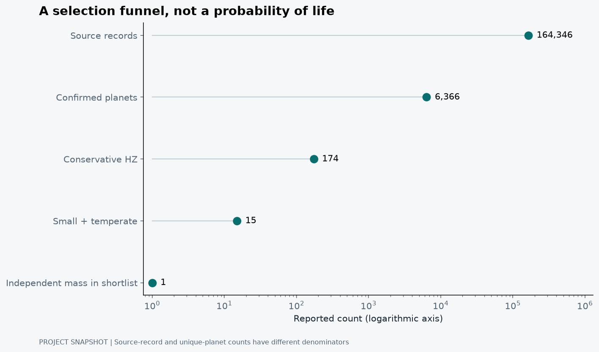
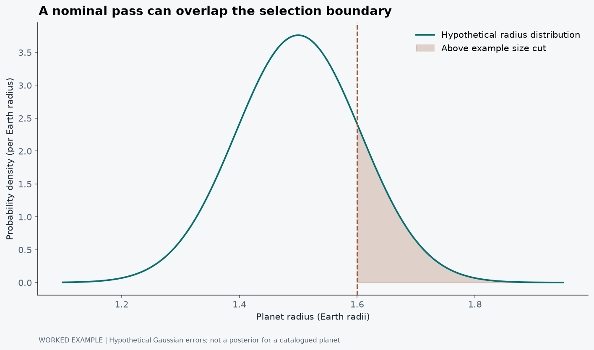

## Earth 2.0 is a question, not a catalogue column

“Earth-like” is a very efficient phrase. It manages to suggest a rocky surface, blue oceans, a tolerable atmosphere and perhaps something looking back at us, all before anyone has mentioned an uncertainty interval. A catalogue usually provides considerably less.

That gap is what interests me in Finding Earth 2.0. I wanted to move from a familiar question, which known planets might resemble Earth in some measurable ways, to a reproducible chain of selection and evidence. Not a list of worlds I would like to exist. A list whose entries can be traced back to measurements, assumptions and missing information.

The project name is allowed to be ambitious. The conclusion still has to fit inside the data (Jana, 2026).

## First decide what the shortlist means

Before ranking anything, I need operational criteria. A small measured radius is not the same as a measured rocky composition. A temperate irradiation estimate is not the same as a measured surface temperature. A planet inside a model habitable zone is not a planet known to support life.

Kopparapu et al. (2013) provide widely used climate-model habitable-zone boundaries as functions of stellar properties. These are conditional physical models, not observations of oceans on each selected planet. Their assumptions and calibrated stellar-temperature range belong in the analysis, particularly when a catalogue host lies outside that range.

I have already written a general habitable-zone explainer. The different question here is what happens when those ideas meet a real archive: which columns exist, which values disagree, which uncertainties cross a cut, and which attractive candidates remain poorly characterised?

## The funnel gets smaller. The knowledge does not grow automatically.

The analysis snapshot used here contains 164,346 source records, 6,366 confirmed planets, 174 conservative habitable-zone entries and 15 strict small-and-temperate candidates. Only one of that final set has an independently measured mass in the stated evidence screen (Jana, 2026).

These counts describe one analysis snapshot. Archive totals change as measurements and entries are updated, so combining stages from different catalogue versions would make the funnel internally inconsistent. The question is what each selection means within this particular analysis, not whether its headline total is the largest available today.

These are different stages with different units of counting. The first count is source records across archives, not 164,209 unique planets. The later counts describe a selected catalogue and explicit filters. They are not an estimate of how many Earth analogues exist in the Galaxy.

<figure><figcaption>Finding Earth 2.0 analysis snapshot. The logarithmic count axis keeps every stage visible. Source records and unique planets have different denominators. This is an evidence-selection diagram, not an occurrence-rate estimate or a probability-of-life calculation. Source: Jana (2026), drawing on public astronomical archives.</figcaption></figure>

Read the plot as a sequence of questions, not as a competition to reach the smallest number. Which records describe the same system? Which planets satisfy the declared physical cuts? Which properties are directly measured, inferred from another quantity, or simply absent? The final row is especially important because it shows where our knowledge becomes thin.

A short list can be useful precisely because it exposes that thinness. Fifteen names are easy to display. Knowing what those names actually represent takes more work.

## A predicted mass is useful. It is still predicted.

Transit observations constrain a planet-to-star size ratio. A radius estimate therefore inherits stellar information. RV observations constrain a different combination of mass and orbital geometry. Not every planet has both, and not every published value has the same evidential status.

Chen and Kipping (2017) provide a probabilistic mass-radius forecasting framework. Such a relation can support planning, but an estimate drawn from it is not an independent dynamical mass measurement. The intrinsic spread in the relation also matters; a single predicted number can make the knowledge look sharper than it is.

In an evidence table, I want those categories visible. Measured, model-inferred and missing should not all become a green tick labelled “available”. Otherwise the ranking quietly rewards us for replacing unknowns with assumptions and then forgetting that we did so.

## The star is inside the uncertainty budget

The planet's inferred radius depends on the star's radius. Irradiation depends on stellar luminosity and orbital distance. Changes to stellar parameters can therefore move a planet across a size or habitable-zone boundary without any change in the transit observations themselves.

For incident flux, a useful scaling is S/S_earth = (L_star/L_sun)/(a/AU)². If luminosity and orbital-distance errors were small and independent, their fractional contributions would combine approximately in quadrature, with the distance contribution multiplied by two. That is a local approximation, not permission to assume that every catalogue error is Gaussian or independent.

A better shortlist should carry uncertainty through the selection. An object just inside a boundary with a broad uncertainty distribution should not be described with the same confidence as one securely inside under the model. Sensitivity to alternate stellar and climate assumptions is part of the result.

## No spectrum is not evidence of no atmosphere

The project's current cross-match finds no tabulated wavelength spectrum for the exact 15 strict candidates in its coverage screen. That is a statement about the searched resources and matching procedure (Jana, 2026). It does not establish that their atmospheres are absent, that life is absent, or that no relevant observation exists anywhere.

This is where archive work becomes surprisingly philosophical in a very practical way. “Not found” is an outcome of a query. “Does not exist” is a much larger claim. The source list, matching rules and retrieval date help keep the first from accidentally becoming the second.

The missing evidence can still guide follow-up. A better stellar radius, an independent mass, a longer orbital baseline or a suitable atmospheric observation may answer a more useful question than another decimal place in a similarity index.

## Radius carries the star inside it

For a small planet and a simplified uniform stellar disc, the transit depth is approximately δ = (R_p/R_star)². Therefore R_p = R_star√δ. Limb darkening, impact parameter, contamination and the actual light-curve fit complicate the measurement, but even this simple equation shows why the planet's radius is not determined independently of the star.

Consider a teaching example with a five per cent stellar-radius error and a ten per cent relative error on transit depth. Because the square root halves the latter contribution, independent small-error propagation gives a planetary-radius error of √(0.05² + 0.05²), or about 7.1 per cent. Improving the photometry alone eventually runs into the stellar-radius term.

A simplified radius uncertainty budget

(σRp/Rp)² ≈ (σRstar/Rstar)² + ¼(σδ/δ)²

Independent, small errors are assumed. A joint light-curve and stellar analysis may contain correlations and non-Gaussian distributions that this expression does not represent.

Now place a hypothetical planet at 1.50 Earth radii with that 7.1 per cent Gaussian uncertainty. Its standard deviation would be about 0.106 Earth radii. A nominal selection boundary at 1.6 is less than one standard deviation away. A binary “passes the size cut” label would conceal a meaningful chance of being above it. This example is not the posterior of a particular shortlisted object.

## Why a habitable-zone membership can be uncertain

The incident-flux estimate scales as L_star/a². Under independent small errors, a ten per cent luminosity uncertainty and a two per cent orbital-distance uncertainty contribute approximately √(0.10² + 0.04²), or 10.8 per cent, to the relative flux uncertainty. Stellar temperature also changes the climate-model boundary against which that flux is compared.

<figure><figcaption>Worked uncertainty example for the hypothetical 1.50-Earth-radius planet described above. Shading marks radii above the example cut. This is not an inferred distribution for any actual shortlisted planet; it illustrates information that a yes/no label can hide.</figcaption></figure>

It is therefore better to ask what fraction of an object's joint parameter distribution satisfies a specified climate boundary than to compare two best-fit numbers and stop. Monte Carlo propagation can draw from a defensible joint posterior and evaluate the criterion for every draw. It should not manufacture independent Gaussian samples from asymmetric, correlated or poorly constrained values simply because that is easy to code.

Kopparapu et al. (2013) describe model boundaries over a stated stellar-temperature range. The project's strict counts respect that range. It also records an alternate extrapolated selection separately. A host just outside the calibration domain is not made physically equivalent to one at the boundary by silently clipping its temperature. The effect of that assumption should remain visible in the selection result.

## A measured mass changes the kind of question we can ask

A planetary radius alone does not determine bulk density. If independent mass and radius measurements are available, density scales as ρ ∝ M/R³. With independent small relative errors, the approximate density uncertainty is √[(σ_M/M)² + 9(σ_R/R)²]. Even a fairly modest radius error can matter because it enters three times in the relative differential.

For an illustrative 20 per cent mass error and five per cent radius error, the combined density uncertainty is about 25 per cent. That still does not uniquely identify interior composition. Different mixtures and atmospheric envelopes can produce similar bulk properties. The point is not that mass solves everything; it is that a measured mass adds evidence that a radius-to-mass forecast does not independently supply.

The RV semi-amplitude constrains a mass combination that also depends on stellar mass, period, eccentricity and inclination. A transit can constrain the inclination, but the full inference still needs those other parameters. A catalogue column labelled mass can therefore contain different kinds of quantities, including M sin i, upper limits and model estimates. The evidence classification is not clerical detail.

## The strict spectrum screen is a coverage experiment

The project's atmospheric cross-match finds no indexed tabulated spectrum for its exact strict shortlist. Nearby comparison objects do have entries, but they do not all pass the same size-and-climate selection. This is why selecting an attractive atmospheric plot from a nearby sample and placing it beside the strict shortlist would mislead a reader about what has actually been measured.

For example, the saved screen includes TRAPPIST-1 b as a comparison entry with a single eclipse-band measurement. A broadband eclipse point is not a resolved transmission spectrum. K2-3 c and d appear with sparse wavelength coverage, while their strict membership flags differ from the final shortlist. The observational method and the selection label have to travel with each value (Jana, 2026).

| Quantity in the evidence table | What it can support | What it does not establish by itself |
|:---|:---|:---|
| Transit radius | A size estimate conditional on the star and light-curve model | Rocky composition or a surface ocean |
| Independent mass and radius | A bulk-density constraint | A unique interior or atmosphere |
| Incident flux and host temperature | Membership in a specified climate-model selection | A measured surface temperature |
| One broadband eclipse point | A band-integrated day-side constraint under a model | A resolved molecular spectrum |
| A similarity score | An ordering under declared weights | Probability of life |

## The observed shortlist is not an occurrence rate

Transit probability is roughly (R_star + R_p)/a for a circular orbit with random orientations. Even before the detector or pipeline is considered, most planetary orbits do not present a transit to us. Observing windows, gaps, signal recovery, false alarms and vetting introduce further selection.

An observed count therefore cannot be divided by an arbitrary number of catalogue stars to estimate how common Earth-like planets are. A population model needs the stars actually searched, their detection efficiency and the reliability of selected signals. Formally, an expected detected count combines a planet population f(θ) with a selection probability p_det(θ) over the relevant parameter space.

This distinction is why the project's catalogue ranking and its separate survey-population work should not be collapsed into one funnel. The funnel asks which known records satisfy the current criteria. Population inference asks what those detections imply about a wider population after accounting for the experiment that could have detected them. They do not have the same denominator.

## Which next measurement would actually help?

A useful follow-up decision starts with an objective. Reducing the radius uncertainty is one objective; deciding between atmosphere models is another. An observation can be informative about one parameter while barely changing the conclusion we care about. A more precise value is not automatically the most valuable next value.

For an object whose size uncertainty is dominated by the host star, better stellar characterisation can be relevant. For another with a robust radius but no independent mass, a feasible dynamical constraint may change the interpretation more. For an atmosphere question, target brightness, stellar contamination, the observing method and expected signal all matter.

I would therefore show both the expected benefit and the assumptions behind it. A hypothetical improvement should remain a scenario, not be displayed as a measurement already obtained. That is the practical purpose of an evidence-led shortlist: to make the missing information specific enough that we can ask how to obtain it.

## What I want a ranking to do

I want it to organise questions. Which candidate is well measured? Which is sensitive to one assumption? Which next observation could most reduce the uncertainty we actually care about? Those are decisions an evidence-led interface can help make.

I do not want it to manufacture a probability of life from a set of weights chosen for physical similarity. A weighted score has the meaning supplied by its definition and calibration. It does not become a biological posterior because it is displayed as a percentage.

There may be another Earth somewhere in these archives, or somewhere our present surveys barely touch. This project cannot settle that. What it can do is make the route from an exciting name to a defensible question a little clearer. For now, that is a better use of a shortlist than pretending we have found a second home.

## References

Chen, J. and Kipping, D. (2017) ‘Probabilistic forecasting of the masses and radii of other worlds’, <em>The Astrophysical Journal</em>, 834, 17. Available at: <a href="https://doi.org/10.3847/1538-4357/834/1/17">https://doi.org/10.3847/1538-4357/834/1/17</a>.

Jana, B. (2026) <em>Finding Earth 2.0 in Distant Worlds</em> [Software and analysis release]. Available at: <a href="https://github.com/Biswajit1999/finding-earth-2">finding-earth-2</a> (Accessed: 21 October 2026).

Kopparapu, R.K. et al. (2013) ‘Habitable zones around main-sequence stars: New estimates’, <em>The Astrophysical Journal</em>, 765, 131. Available at: <a href="https://doi.org/10.1088/0004-637X/765/2/131">https://doi.org/10.1088/0004-637X/765/2/131</a>.

