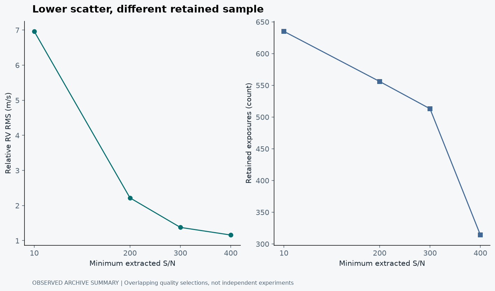
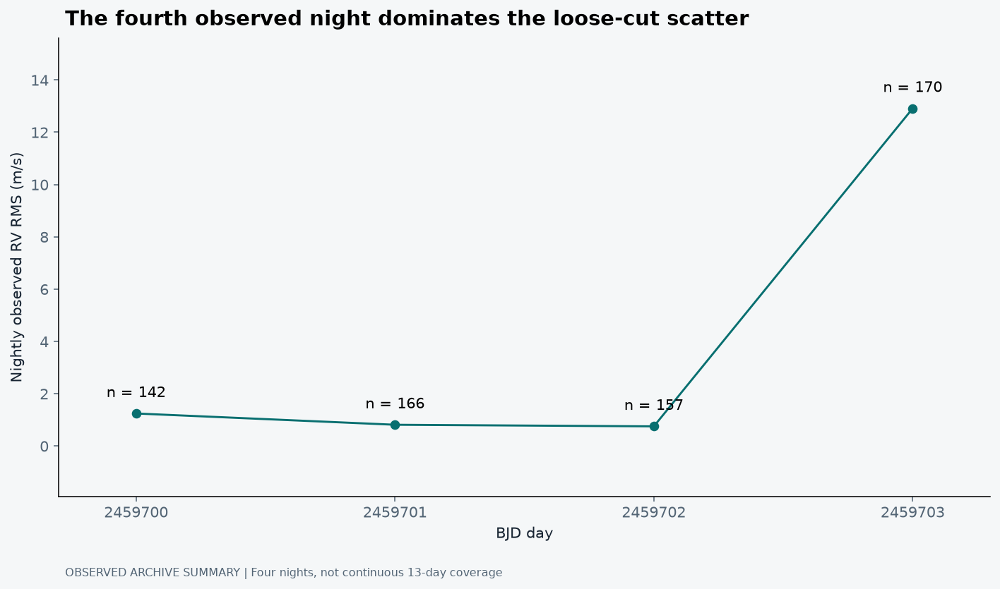
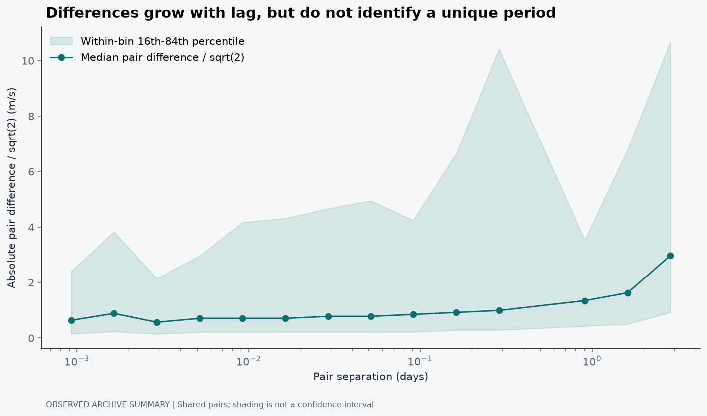

## The line got quieter. What did we actually improve?

There is a very satisfying thing a data-analysis script can do: remove some points and produce a much calmer plot. The scatter falls. The result looks more precise. For about three seconds, it feels as though the instrument has become better because I changed a threshold in Python.

Of course, the instrument did not change. The sample did.

That distinction became the central question in my NEID solar RV audit. I wanted to know how the measured scatter behaved across nights and under declared signal-to-noise cuts. The useful outcome was not a recovered planet or a model that removed solar activity. It was a demonstration that the apparent stability of this particular archive sample depends strongly on the observations I keep (Jana, 2026).

## Start with the archive, not the preferred answer

The saved query covers BJD 2459700-2459713 and returns 2,000 public NEID Level-2 solar metadata records. The project's existing acceptance rule retains 635 exposures across four observed nights. Thirteen days in the query window is therefore not thirteen days of continuous accepted coverage. That missing distinction would make a time-series story sound much stronger than the actual sampling allows.

The official archive describes the returned RV, uncertainty, extracted signal-to-noise and quality flags. It also warns that flagged products may not be suitable for precision RV work (NExScI, n.d.). I retain that provenance rather than treating a downloaded number as automatically analysis-ready.

Even an accepted Level-2 value is not a promise that all uncertainty has been captured. The formal RV error and the observed variability answer different questions. The first comes from a measurement procedure; the second can include solar signals, imperfect corrections, environmental effects and shared systematics. This audit does not isolate those contributions.

## More photons help, but they do not explain everything

The photon-noise limit depends on both photon statistics and the Doppler information in the spectrum, not on a signal-to-noise number alone (Bouchy, Pepe and Queloz, 2001). It is reasonable to expect low-quality exposures to be less precise. It is not reasonable to assume that every change in scatter under an S/N cut measures photon noise and nothing else.

S/N can be related to observing conditions and solar altitude. A stronger threshold may therefore change when we observed, which night contributes most, and which parts of the Sun-as-a-star time series remain. The comparison is not automatically like-for-like. It is a changed dataset with an unchanged label unless we make that change visible.

<figure><figcaption>Observed archive-derived project summary. The left panel shows relative-RV RMS under four fixed S/N thresholds; the right shows the retained sample size. Both panels use the pinned NEID audit JSON. These are selection diagnostics, not an activity-correction result or a causal experiment.</figcaption></figure>

At the loose S/N threshold of 10, the reported RMS is about 6.96 m/s. At 400, it is about 1.16 m/s. But the retained sample also falls from 635 to 314 exposures. The plot deliberately shows those facts side by side. A factor-of-six change in scatter is interesting; losing roughly half the observations is part of its interpretation, not a footnote.

I would not attach invented error bars to these four points. They summarise overlapping selections, not four independent experiments. Uncertainty in a sensitivity analysis needs a resampling or generative scheme that respects the time structure and dependence. Simply drawing a familiar-looking uncertainty band would not supply one.

## Look at the nights before averaging them away

The fourth observed night dominates the loose-cut variability. The project's nightly RMS values range from roughly 0.75 to 12.91 m/s. The nightly reduced chi-squared values are also far above one under the quoted formal errors (Jana, 2026). That is a reason to investigate the uncertainty model and the data, not permission to name the cause.

<figure><figcaption>Nightly observed RMS from the same accepted sample. Labels show exposure counts. The conspicuous fourth-night scatter motivates inspection of observations and quality variables; this figure does not establish whether the cause is solar, atmospheric, instrumental or a combination.</figcaption></figure>

An aggregate statistic mixes within-night variation, differences between nights and the weighting implied by the number of exposures. If I show only the final RMS, I hide the structure that explains why a quality cut has such leverage. A nightly panel is less dramatic than an impressive single precision figure, but it is much more useful.

## A time lag is not a rotation period

The project also compares velocity differences at different time separations. That can describe how the series varies over short and longer lags. However, many pairs reuse the same exposures. A large pair count does not create the same number of independent observations.

With only four accepted nights in a discontinuous window, I cannot infer the solar rotation period from the rise of a descriptive structure function. Nor can I translate a correlation with solar altitude into a causal correction. The sampling and the unmodelled variables remain in the room even when the plot looks smooth.

The red-noise lesson is familiar from transit work too: correlated measurements do not reward averaging in the same way as independent errors (Pont, Zucker and Queloz, 2006). That paper is about transit detection, not a validation of this NEID model. I am borrowing the statistical warning, not importing its results as solar-RV evidence.

## The acceptance rule is part of the experiment

The saved query asks for the first 2,000 rows in time order within the declared BJD interval. It is a capped archive extraction, not a claim to have downloaded every exposure available in that interval. The local acceptance rule is archiveFlag = 0, formal RV uncertainty below 10 m/s, and extracted S/N at least 10. Stronger S/N thresholds are applied after that archive-quality screen.

The saved metadata records 1,363 archive-flagged exposures. Of the remaining 637 rows, 635 pass the complete local rule. Those counts are useful because they separate an archive decision from my own analysis selection. An archive flag is not a physical diagnosis, and a passed local rule does not certify that an observation is suitable for every scientific purpose.

The four threshold results are worth showing numerically as well as graphically:

| Minimum S/N | Retained exposures | Centred RV RMS (m/s) | Fraction of initial accepted sample |
|---:|---:|---:|---:|
| 10 | 635 | 6.963 | 100.0% |
| 200 | 556 | 2.219 | 87.6% |
| 300 | 513 | 1.377 | 80.8% |
| 400 | 314 | 1.159 | 49.4% |

The rows are nested selections. The fraction column describes retention relative to 635 accepted exposures, not completeness relative to all solar observations or all possible observing conditions. The final sample is more selective, but that word should not be translated automatically into less biased.

## Even “RMS” needs a definition

The threshold analysis computes the square root of the mean squared deviation from each selected sample's arithmetic mean. It uses a denominator of n, not n - 1. This is a descriptive population-style scatter for the saved sample, not an unbiased estimate of a universal solar variance.

The statistic actually plotted

v̄ = (1/n) Σvᵢ RMScentred = √[(1/n) Σ(vᵢ - v̄)²]

The mean is recomputed for each quality selection. A relative-velocity zero point cancels from this centred statistic but not from √mean(vᵢ²).

This resolves a small but important trap in the saved products. The compact input bundle's older diagnostic reports about 8.12 m/s for an uncentred RMS of the relative velocities. The later threshold analysis reports about 6.96 m/s after centring on the selected sample mean. Those need not agree. Adding a constant velocity offset changes the first statistic but not the second. The numerical identity is mean(v²) = mean[(v - v̄)²] + v̄².

That is not a reason to choose whichever number looks better. It is a reason to identify the implementation behind the number and use one definition consistently. In this article, the threshold plot and table use the centred definition from the analysis code.

## Tiny formal errors can coexist with large observed variability

For each observed BJD day, the project calculates an inverse-variance weighted mean. With wᵢ = 1/σᵢ², the mean is Σwᵢvᵢ/Σwᵢ and its formal error is 1/√Σwᵢ, assuming independent measurements with correctly specified uncertainties. That is a conditional precision, not a guarantee about the underlying Sun-as-a-star signal.

| BJD day | n | Weighted mean relative RV (m/s) | Formal mean error (m/s) | Observed RMS (m/s) |
|---:|---:|---:|---:|---:|
| 2459700 | 142 | -2.515 | 0.0181 | 1.241 |
| 2459701 | 166 | -1.874 | 0.0155 | 0.811 |
| 2459702 | 157 | -3.788 | 0.0168 | 0.749 |
| 2459703 | 170 | -4.907 | 0.0318 | 12.910 |

The nightly RMS column is calculated around the weighted mean, whereas the quality-cut RMS is centred on an arithmetic mean. That distinction is small enough to overlook and important enough to document. Also, these groups are defined by floor(BJD). They are convenient observing-day groups in this extraction, not a general algorithm for identifying a night's boundaries at every observatory.

Reduced chi-squared compares residuals with the quoted σᵢ. Values from 13.36 to 180.35 indicate that a constant nightly value plus those independent formal errors is not an adequate description. Multiplying every error bar by a fitted factor might make chi-squared look conventional, but it would not identify why the data vary.

## Correlation changes the uncertainty of an average

If the covariance matrix is C, an arithmetic average has variance (1/n²) 1ᵀC1. Only when off-diagonal terms vanish does that reduce to a sum of independent variances divided by n². A slowly varying calibration term or solar signal can make neighbouring exposures share errors. Taking many such exposures does not create the same information as the same number of independent measurements.

The photon-information calculation in Bouchy, Pepe and Queloz (2001) is a useful lower-level component, but it is not a complete covariance model for a night of observations. Likewise, thermal stability of the spectrograph does not remove the Sun's own changes. The practical job is to identify which process each diagnostic can constrain rather than make one uncertainty column carry all of them.

## Read the time-lag curve as a description, not a period detection

The project's lag statistic is the median of |vᵢ - vⱼ|/√2 in bins of pair separation. The shaded range below shows the 16th to 84th percentiles of the pair differences. It is a distribution of differences, not a confidence interval on an independently estimated population parameter.

<figure><figcaption>Observed pair-difference summary from the saved NEID analysis. Horizontal coordinates are geometric bin midpoints. Shading shows the within-bin 16th-84th percentile range, not uncertainty on the median. Pairs share exposures, and gaps in coverage remain relevant.</figcaption></figure>

Larger differences at longer lags mean that widely separated values in this sample tend to differ more. They do not establish a unique periodicity. Even for independent Gaussian measurements with standard deviation σ, the median absolute difference divided by √2 is about 0.6745σ, not σ itself. Treating the curve as a directly calibrated RMS would introduce another avoidable definition error.

A proper activity-correction study would need explanatory measurements and a validation design. Holding out individual exposures while keeping adjacent observations from the same night in training would be a weak test for slowly correlated behaviour. Holding out complete nights, with enough nights to repeat the exercise, is more relevant to the claim that a model generalises across observing conditions. This four-night audit is not yet that experiment.

## What would make the next analysis stronger?

I would inspect the full Level-2 products and relevant activity indicators, compare quality variables without conditioning on the RV outcome, and extend the temporal baseline. I would test whether a proposed correction predicts unseen nights rather than merely reducing the scatter of the nights used to fit it.

I would also report the observations rejected by every rule. If the cleanest result depends on removing one inconvenient interval, a reader should be able to see that interval and understand the reason. Predeclared cuts are helpful, but they do not make selection bias impossible.

The honest conclusion is quite specific: this sample's measured solar RV scatter is sensitive to quality selection and night-to-night composition. That is not a failed version of a planet discovery. It is a useful audit of the steps that would have to be understood before trusting a more ambitious claim.

The quieter plot is allowed to be satisfying. It is just not allowed to do all the explaining.

## References

Bouchy, F., Pepe, F. and Queloz, D. (2001) ‘Fundamental photon noise limit to radial velocity measurements’, <em>Astronomy &amp; Astrophysics</em>, 374, pp. 733-739. Available at: <a href="https://doi.org/10.1051/0004-6361:20010730">https://doi.org/10.1051/0004-6361:20010730</a>.

Jana, B. (2026) <em>NEID Solar RV Variability and Quality-Cut Audit</em> [Software and analysis outputs]. Available at: <a href="https://github.com/Biswajit1999/rv-activity-disentangler">rv-activity-disentangler</a> (Accessed: 21 October 2026).

NASA Exoplanet Science Institute (NExScI) (n.d.) <em>Solar Radial Velocity Archive: help and column descriptions</em>. Available at: <a href="https://neid.ipac.caltech.edu/help_solar.php">NEID Solar RV Archive documentation</a> (Accessed: 21 October 2026).

Pont, F., Zucker, S. and Queloz, D. (2006) ‘The effect of red noise on planetary transit detection’, <em>Monthly Notices of the Royal Astronomical Society</em>, 373, pp. 231-242. Available at: <a href="https://doi.org/10.1111/j.1365-2966.2006.11012.x">https://doi.org/10.1111/j.1365-2966.2006.11012.x</a>.

