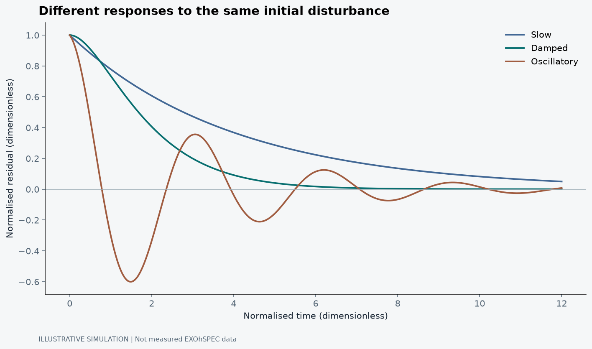
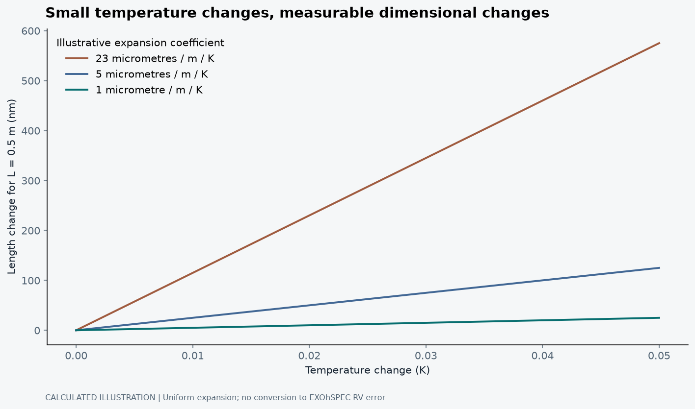

## The planet is far away. The problem is on the bench.

I like the part of astrophysics where a very large question eventually becomes a very small movement. We want to know whether a star has a planet. Somewhere in that chain, we end up asking whether an optical component moved, whether a sensor drifted, or whether the temperature changed while nobody was looking. The Universe is enormous. The measurement can still be ruined locally.

My MSc project was on a closed-loop feedback control system for EXOhSPEC development at the University of Hertfordshire. The public thesis archive records that work and its supervision by Hugh R. A. Jones and William E. Martin (Jana, 2024). This post is about the measurement problem behind it, rather than a claim about new, unpublished laboratory performance. The distinction matters. A public research story should not quietly acquire results that were never released.

I have already written about control systems and PID. Here I want to go one step further: what exactly are we trying to hold still, and how would we know that the control system helped the science?

## A stable sensor reading is not the whole instrument

A spectrograph spreads light into wavelength. Radial-velocity work then asks how far spectral information has shifted. At velocities small compared with the speed of light, the useful scale is Δλ/λ ≈ v/c. A velocity of one metre per second corresponds to a fractional shift of roughly three parts in a billion. That is a scaling calculation, not a claim that every pixel directly resolves such a displacement.

The information is distributed across many spectral slopes. Bouchy, Pepe and Queloz (2001) explain how photon noise, spectral structure and instrumental resolution affect the attainable RV precision. Collecting more photons helps, but a moving wavelength scale is not repaired simply by collecting more of them. Random uncertainty and changing instrument response are different problems.

Temperature can alter dimensions, alignment and refractive properties. Pressure changes can alter the refractive index of air. Mechanical motion can change where light lands. The detector, illumination and calibration add their own behaviour. None of this means every drift is thermal, or that one thermometer measures every relevant degree of freedom. That would be a wonderfully convenient instrument. It is not a safe assumption.

## Follow the measurement all the way around

A feedback loop needs a controlled quantity, a sensor, a controller and an actuator. The sensor reports a value; the controller compares it with a setpoint; the actuator changes the physical system. The next measurement tells the controller what happened. The arrows are simple. Their timing is not.

There is a delay between applying power and moving a temperature. There can be another delay between changing an enclosure temperature and changing an optical component. A sensor attached at one location does not automatically report the temperature of the component that matters most. A controller can therefore be very pleased with itself while the optical path is still moving.

That is why I would judge the system using more than the control error. I would want the environmental record, actuator demand, independent checks and an optical observable on a shared time axis. If the temperature trace improves but the spectral position does not, the result is telling us something important. We may be stabilising the wrong proxy, or the remaining error may come from elsewhere.

<figure><figcaption>Illustrative simulation, not EXOhSPEC measurements. The same initial offset produces different responses in three simple models. Time and residual temperature are normalised; there is no conversion to RV.</figcaption></figure>

The useful part of this plot is not which line looks prettiest. The slow response leaves an error for longer. The oscillatory response crosses the target repeatedly. The damped response approaches it without the same ringing. These are different compromises between response speed and stability. The curves do not tell us which controller should be installed on an actual instrument; that requires a measured plant, delays, noise and operating constraints.

## Why turning the gain up is not a research strategy

The proportional term reacts to the present error. Integral action accumulates error and can remove a persistent offset. Derivative action reacts to the rate of change, but it also needs care around noisy measurements. In a physical system, the actuator has a finite range. An integral term that continues accumulating while the actuator is saturated can create a long recovery problem. The controller has effectively been making promises the heater cannot keep.

I would therefore test disturbance rejection, saturation, recovery and sensor failure separately. A good response to one small step is not a complete operating envelope. The relevant question is whether the system behaves sensibly across the conditions in which the instrument will actually be used.

Environmental control in precision RV instruments provides a useful comparison, not a transferable specification. Robertson et al. (2019) describe NEID's control architecture and performance demonstration. Their system shows why thermal design, insulation, vacuum engineering and monitoring belong together. It does not mean an EXOhSPEC subsystem inherits NEID's stability merely because both use feedback.

## The plot I would trust needs context

Suppose a report says that a controlled signal has a small RMS. I would ask: over what duration, at what sampling cadence, and after which warm-up exclusion? Was a trend removed? Was the room unusually quiet? Was the instrument being touched? Did the sensor resolution put an artificial floor under the result? A number without those details is hard to compare with anything.

I would also separate in-loop and out-of-loop measurements. The in-loop sensor is part of what the controller is actively minimising. An independent sensor or optical diagnostic asks whether that apparent improvement survives outside the loop. Agreement is useful evidence; disagreement is not an inconvenience to hide in an appendix.

For a future public results figure, I would show the time series before the summary statistic, identify the uncontrolled comparison, report units and calibration, and preserve the unprocessed record. I would not turn the illustrative response above into an experimental result by changing its caption. The axes would still know.

## Put a velocity onto the detector, carefully

It helps to put actual scales beside the phrase “high precision”. Take an illustrative spectrograph with resolving power R = 100,000 and a resolution element sampled by three detector pixels. Those are example values, not a specification I am assigning to EXOhSPEC. One resolution element spans a velocity scale of c/R, about 3,000 m/s. One pixel then corresponds to about 1,000 m/s in this simplified local dispersion picture.

A one-metre-per-second displacement is therefore about one thousandth of a pixel. At 550 nm, the corresponding wavelength change is about 0.00000183 nm. Neither calculation says that a single pixel measures a planet with that accuracy. They say that a small change in the combined spectral information must be distinguished from small changes in the instrument's mapping of wavelength onto the detector.

An illustrative sampling scale

Δvpixel ≈ c / (R nsampling) Δxpixel ≈ v R nsampling / c

R is dimensionless, nsampling is pixels per resolution element, and c and v must use the same velocity units. The result is a local scale, not a complete wavelength solution.

The reason sub-pixel inference is possible is that the model uses a sampled profile, not an integer pixel address. The reason it is difficult is that profile changes, illumination changes and wavelength-calibration errors can imitate part of the inferred shift. Bouchy, Pepe and Queloz (2001) quantify the photon-information side through a quality factor Q. In their framework, σ_RV scales as c/(Q√N_e), with N_e the detected photoelectrons under the stated normalisation. More photons reduce that term; they do not guarantee that the profile model stayed correct.

## A thermal number becomes an optical question

For a uniform object with a constant expansion coefficient, the elementary estimate is ΔL = α L ΔT. Consider a half-metre length and a temperature change of 0.01 K. With an illustrative α of 23 × 10⁻⁶ K⁻¹, the length change is 115 nm; with α of 1 × 10⁻⁶ K⁻¹ it is 5 nm. This is why material choice and thermal stability belong in the same conversation.

However, I cannot convert either number directly into an RV error without the optical geometry and how the relevant motion projects onto the measurement. A common expansion can behave differently from a temperature gradient that tilts a component. An enclosure sensor can miss that gradient even when its own time series looks excellent. The next step is an optomechanical sensitivity model or an experimentally measured transfer from environmental change to optical displacement, not a guessed conversion factor.

<figure><figcaption>Calculated illustration using ΔL = αLΔT for L = 0.5 m. The coefficients are example parameters, not fitted EXOhSPEC material properties. The figure shows how a small temperature excursion becomes a dimensional change; it does not predict a wavelength shift or RV error.</figcaption></figure>

The steeper line is not “worse astronomy” by itself. Its significance depends on what that length does in the optical train. This is a useful place to pause in an instrumentation discussion: we have calculated a physical effect, but we have not yet calculated its effect on the scientific observable.

## Feedback has a frequency response, not just a gain knob

A first thermal approximation might write C_th dT/dt = P - G_th(T - T_room), where C_th is heat capacity in J/K, G_th is thermal conductance in W/K and P is heater power in W. The ratio C_th/G_th has units of seconds and sets a characteristic response time. It explains why a thermal plant cannot instantly follow a controller's demand.

Add a transport delay, a sensor response and an actuator limit, and the loop becomes more than this first-order equation. A controller that works slowly may reject room-temperature drift while leaving faster disturbances almost unchanged. Increasing gain shifts that trade-off, but delays also change phase. Large correction arriving too late can reinforce the error instead of cancelling it.

For a linear negative-feedback loop, define the open-loop response L(s) as controller times plant. The sensitivity S(s) = 1/[1 + L(s)] describes one disturbance path; the complementary sensitivity T(s) = L(s)/[1 + L(s)] describes another. Their algebraic sum is one. In this standard arrangement, measurement noise can be fed into the physical output through a path proportional to T, even while the in-loop error appears small.

That is the practical reason I keep coming back to an independent optical check. The controller can suppress the error signal partly by moving the plant in response to sensor noise. A quieter displayed error is not sufficient evidence of a quieter physical instrument. Which disturbance enters where must be stated before using S or T as an explanation.

## Ask about the timescale of stability

An RMS over ten minutes and an RMS over ten hours are not interchangeable specifications. Slow drift may be invisible in the short record. A long record can contain warm-up behaviour or an environmental change that a short test never encounters. The cadence also determines which fluctuations can be resolved rather than averaged within one sample.

One useful diagnostic is Allan deviation. For consecutive averages of duration τ, its squared value is one half of the mean squared difference between adjacent averages. It asks how reproducible the measurement is over a particular averaging time, rather than compressing every timescale into one scatter number. Under suitable independent white-noise assumptions the deviation falls roughly as τ⁻¹ᐟ²; slow drift can eventually reverse that improvement. Real sampling gaps and overlapping averages require care in implementation.

I would use it alongside a time series and a power spectrum, not as a replacement for them. The time series can expose a step. The spectrum can reveal a repeating disturbance. The averaging-time plot can show when waiting longer stops helping. Agreement across these views is more informative than choosing the one statistic that makes a run look most stable.

## What a convincing control demonstration would contain

A useful experiment would first identify a safe operating range and a baseline, then apply a declared disturbance while recording the room, in-loop sensor, independent sensor, actuator and optical observable together. I would report settling time, overshoot, residual scatter and the controller's demand. I would also repeat the test rather than selecting one good-looking trace.

For comparison, Robertson et al. (2019) demonstrate NEID's environmental system as a complete engineering architecture, not merely an attractive PID response. The relevant lesson is to connect stability claims to where and how they were measured. Their achieved performance is specific to their instrument and test conditions.

If the environmental metric improves but the optical metric does not, that is a diagnostic result. If both improve only during quiet hours, that limits the claim. If the actuator spends most of the run saturated, the nominal tuning is not describing the actual operating regime. These are the details I would want a researcher to find before deciding that the loop is ready for scientific use.

## The bridge is practical

This is why instrumentation became the link between my electronics background and astrophysics. The scientific objective gives the control problem meaning. The hardware makes the assumptions testable. Software lets us inspect what happened, but it cannot make a missing independent measurement appear afterwards.

Keeping a spectrograph stable is not about winning an argument with one temperature trace. It is about reducing instrumental ambiguity so that a small astronomical change has somewhere credible to stand. Before asking the star to reveal a planet, we need to understand what our own instrument is doing.

## References

Bouchy, F., Pepe, F. and Queloz, D. (2001) ‘Fundamental photon noise limit to radial velocity measurements’, <em>Astronomy &amp; Astrophysics</em>, 374, pp. 733-739. Available at: <a href="https://doi.org/10.1051/0004-6361:20010730">https://doi.org/10.1051/0004-6361:20010730</a>.

Jana, B. (2024) <em>Closed-Loop Feedback Control System for EXOhSPEC Development</em>. MSc thesis. University of Hertfordshire. Public academic archive. Available at: <a href="https://github.com/Biswajit1999/Master-Thesis-2024">Master-Thesis-2024</a> (Accessed: 21 October 2026).

Robertson, P. et al. (2019) ‘Ultrastable environment control for the NEID spectrometer: design and performance demonstration’, <em>Journal of Astronomical Telescopes, Instruments, and Systems</em>, 5(1), 015003. Available at: <a href="https://doi.org/10.1117/1.JATIS.5.1.015003">https://doi.org/10.1117/1.JATIS.5.1.015003</a>.

