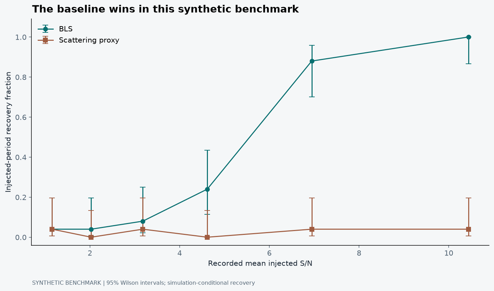
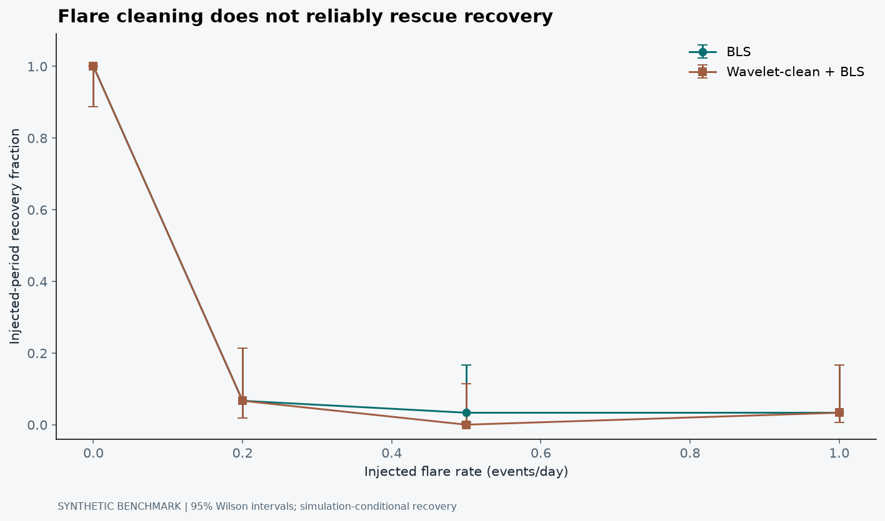
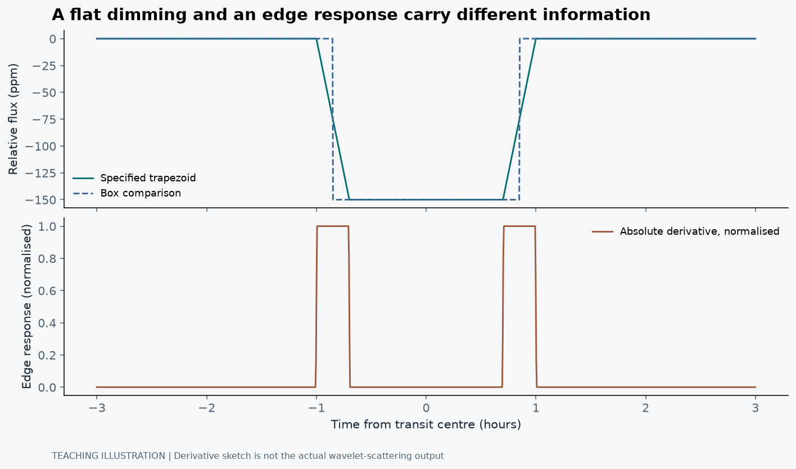

## The simple method was annoyingly good

There is a particular kind of optimism that arrives with a new method. You read about a representation that handles structure across multiple scales, look at a difficult time series, and think: surely these two things ought to get along.

TransitScatter was my attempt to test a version of that idea. Could a wavelet-scattering-style representation improve the recovery of small, periodic transit signals compared with a classical box search? I built a synthetic benchmark so the injected signal, noise model and random seed were known. Then the baseline won (Jana, 2026).

That is not the ending I would choose for a promotional paragraph. It is a much more useful ending for a research note.

## Ask a question that can actually lose

A transit search needs to distinguish a repeated, shallow dimming from noise and other variability. Box Least Squares searches trial periods and compares a brief low-flux interval with the rest of the folded series. The template is deliberately simple, but it is closely aligned with the feature we are trying to detect (Kovács, Zucker and Mazeh, 2002).

The alternative in this project applies a Morlet-filter-bank, modulus and smoothing sequence to build a multiscale detection proxy, then searches it using the same box-statistic core. A third route attempts wavelet-based flare cleaning before BLS. These are particular implementations, not representatives of everything wavelets or scattering transforms could ever do.

The hypothesis needs that level of specificity. Otherwise, every disappointing result can be rescued by saying the real idea was a slightly different algorithm. A useful benchmark gives the method a fair opportunity to fail under declared conditions.

## The stars in this experiment are simulated

Every light curve in the benchmark is synthetic. A trapezoidal transit is injected into white noise plus an Ornstein-Uhlenbeck-like correlated component. The flare experiment adds positive, decaying events. The project records the settings and seeds so that the comparison can be reproduced (Jana, 2026).

That design makes the truth knowable within the experiment. It does not make the noise model a complete description of Kepler, TESS or any real star. Real light curves contain gaps, instrumental systematics, evolving stellar behaviour and reduction decisions that a small benchmark cannot cover automatically.

There is also no new planet here. “Recovery” means recovering an injected period according to the benchmark's matching rule. The word has a precise experimental meaning, and it should keep that meaning when the figure leaves the repository.

## What the recovery curve says

<figure><figcaption>Synthetic benchmark results from the pinned CSV, not survey detections. Each depth setting has 25 trials. Points show successful top-period recovery under the project's harmonic-tolerant matching rule; error bars are 95% Wilson binomial intervals calculated from the recorded trial counts. The horizontal coordinate is the recorded mean injected S/N.</figcaption></figure>

At the easier tested settings, BLS recovers the injected signal far more often than the scattering proxy. The uncertainty bars matter because a few dozen trials cannot estimate an exact recovery probability. A point at zero successes does not prove that the underlying success probability is exactly zero; a point at all successes does not prove universal perfection.

The proper conclusion is narrower than “machine learning loses to classical astronomy”. This specific transformation and search procedure underperform this baseline under these simulated conditions. The benchmark does not test every learned representation, every transit shape or every stellar-noise regime.

## The transform may remove the thing we wanted

A box search benefits from the signed contrast between the lower in-transit flux and the out-of-transit level. A wavelet responds to local structure at its scale, including transit edges. Applying a modulus changes the sign information, and later smoothing changes the temporal structure again.

One plausible explanation for the result is that the chosen proxy preserves features that are useful for some classification tasks while weakening the particular depth information the box statistic uses. That is an interpretation to test, not a proof extracted from the recovery curve alone.

I would examine intermediate representations, change the transformation one component at a time, and compare with a transit-shaped matched-filter method. Hippke and Heller (2019) describe Transit Least Squares, which offers a relevant stronger baseline by using more realistic transit shapes. It is a next comparison to implement, not a method already benchmarked in these CSV files.

## Flares exposed another weakness

<figure><figcaption>Synthetic flare-contamination experiment at the recorded settings, with 30 trials per rate and 95% Wilson intervals. Both methods lose recovery sharply as flares are introduced. Lines connect tested settings for readability; they are not fitted performance laws.</figcaption></figure>

The cleaning route does not reliably rescue the injected transit at these settings. Strong events can distort a period search through accidental phase alignments, not merely increase local variance. A short preprocessing pass may reduce an outlier without eliminating the false period it helps favour.

Correlated noise also changes the detection problem. Pont, Zucker and Queloz (2006) show why transit thresholds cannot safely be predicted using white-noise intuition alone. Their analysis motivates caution; the exact failure pattern here still comes from this project's own synthetic construction and search grid.

## Recovery is not the same as reliability

The benchmark allows a recovered period to match the injected period or certain low-order harmonics within a tolerance. That can be useful, but it is easier than requiring an exact fundamental-period recovery. Both the matching definition and the period grid belong beside the result.

A top-ranked period also says little about false alarms without a null experiment. A detector can become more willing to declare a signal and increase apparent sensitivity while also making more mistakes. Real survey inference requires calibration against no-transit cases, realistic sampling and vetting, not just an attractive injection curve.

The repository's later empirical-null validation is a useful extension, but its probability remains conditional on the simulation. It is not a measured false-alarm rate for a mission catalogue (Jana, 2026). More elaborate terminology would not change that boundary.

## Why the box statistic is a stronger baseline than it looks

Take a trial period, epoch and duration. Those choices assign samples to an in-transit set and an out-of-transit set. Let q be the fraction of total weight inside transit and s the weighted sum of mean-centred flux in that interval. For normalised weights, the fitted dimming depth has a scale -s/[q(1 - q)], and the improvement in the two-level fit is proportional to s²/[q(1 - q)]. The sign condition distinguishes a dimming from a brightening.

The important idea is not the exact normalisation chosen by one implementation. The box averages coherently over a proposed transit interval, then repeats that comparison through trial phase and period. It uses the repeated signal geometry directly, rather than asking a generic feature representation to preserve it by accident (Kovács, Zucker and Mazeh, 2002).

Under independent equal-variance white noise, a rough detection scale is depth times √N_in divided by the per-point noise, with an additional contribution from the out-of-transit baseline uncertainty. Correlated noise can prevent N_in samples from behaving like N_in independent pieces of evidence. The simple scaling is useful for intuition, not a complete threshold calibration.

## Look at the information before and after the transformation

The scattering-style route in this project applies a Morlet filter bank, takes a modulus and smooths the result. Each operation changes the representation of a transit. A zero-mean oscillatory filter responds strongly to changes near ingress and egress. Taking an absolute value removes sign. Low-pass smoothing then changes the localisation of that response.

These are not intrinsically bad operations. They can produce useful invariances in other tasks. The issue is whether the final representation retains the specific signed, phase-coherent depth information needed by the downstream box search. A transform can make a signal look cleaner while making it less useful for a particular statistic.

<figure><figcaption>Teaching illustration, not a rerun of the scattering pipeline. The first panel compares a specified trapezoid with a box. The second shows the absolute numerical derivative of that trapezoid, scaled for visibility, to illustrate edge emphasis and lost dimming sign. It must not be read as the actual Morlet-scattering output.</figcaption></figure>

The flat bottom carries repeated low-flux samples that help a box statistic. The edge-emphasis sketch highlights a different part of the event. It makes the hypothesis behind the failure concrete, but it does not prove that one transformation step caused the measured performance gap. To test that, I would preserve the same simulations and ablate the filter, modulus and smoothing separately.

## Read the small-sample rates as counts

The clean benchmark uses 25 trials at each injected depth. A reported four per cent is one success, not a finely measured four-per-cent law. At the 120-ppm setting, the recorded BLS recovery is 22/25, compared with 1/25 for the scattering proxy. At 180 ppm the values are 25/25 and 1/25.

| Injected depth (ppm) | Recorded mean S/N | BLS successes / trials | Scattering successes / trials |
|---:|---:|:---|:---|
| 20 | 1.16 | 1 / 25 | 1 / 25 |
| 35 | 2.03 | 1 / 25 | 0 / 25 |
| 55 | 3.18 | 2 / 25 | 1 / 25 |
| 80 | 4.62 | 6 / 25 | 0 / 25 |
| 120 | 6.95 | 22 / 25 | 1 / 25 |
| 180 | 10.44 | 25 / 25 | 1 / 25 |

The Wilson intervals in the recovery figure avoid treating zero and complete recovery as perfectly known probabilities. Their binomial interpretation assumes independent trials under a fixed setting. It does not account for uncertainty about whether the simulator represents real stellar data, or for all the analysis decisions that led to this benchmark.

The methods may also be evaluated on the same injected trials. Comparing their marginal confidence intervals is not a full paired significance test. A stronger comparison would preserve trial-by-trial success labels, inspect disagreements on identical light curves, and account for the dependence created by the paired design. This table is descriptive evidence of a large gap, not a substitute for that analysis.

## A wrong period can look surprisingly plausible

A period search tests many candidate folds. Noise or flares can align at one of them, particularly when the statistic is driven by a small number of influential samples. Looking only at the tallest peak after the search hides how many opportunities the procedure had to produce something impressive.

The empirical-null extension in the repository therefore simulates depth-zero light curves, runs the complete search and records the maximum statistic. This is the relevant comparison for a selected maximum, rather than the distribution at a single prespecified period. It also checks the period grid from 80 to 640 trial periods and examines how the null maximum changes with the search (Jana, 2026).

For k exceedances among B null replicates, the implemented tail estimate is (k + 1)/(B + 1). If B = 99 and no simulated maximum exceeds the observed one, that estimate is 0.01, not zero. The value describes the simulation and search procedure used; it is not a one-per-cent probability that a real astronomical claim is false.

Increasing the grid can both improve coverage of the true period and increase opportunities for noise to win. The grid, duration choices, harmonic acceptance and null calibration should therefore be considered together. More trial periods are not automatically more scientific sensitivity at unchanged reliability.

## What the flare result does and does not diagnose

At a flare rate of 0.2 events/day, the saved experiment recovers the injected signal in 2/30 trials for both routes. At 0.5 events/day it records 1/30 for BLS and 0/30 after the wavelet-cleaning route. With counts this small, I would not attach importance to the difference between one and zero as a reliable method ranking.

The robust result is that both approaches struggle badly under this simulator's flare amplitudes, shallow transit and chosen search settings. That could motivate iterative masking, more robust likelihoods or a check on whether the strongest period relies on very few points. It does not establish that all flaring stars are unsuitable for transit searches or that wavelet preprocessing can never help.

Pont, Zucker and Queloz (2006) motivate taking correlated noise seriously in transit detection. The specific flare behaviour here still requires its own controlled tests, because correlated background variation and sparse positive events affect a pipeline in different ways.

## What would be a fairer next comparison?

A transit-shaped template is an obvious next baseline. Transit Least Squares incorporates ingress, egress and limb-darkening structure rather than replacing the entire event with two levels (Hippke and Heller, 2019). Any new comparison should use the same cadence, observing baseline, injected population and false-alarm calibration for all methods.

I would also report separate results for fundamental-period recovery, accepted harmonic recovery, detection without a correct period, and null false positives. These outcomes answer different questions. A method that detects an event but assigns half its period may be useful for candidate generation and still fail a precise orbital-recovery criterion.

Finally, I would test data gaps, changing noise properties and signals not included in method development. A stronger synthetic suite would still be synthetic; an observational injection experiment would add realism but inherit the limitations of the selected real light curves. Each step should earn a narrower uncertainty statement, not simply a more impressive name.

## The result is allowed to be inconvenient

What I like about this exercise is that the disappointing comparison is still actionable. It suggests better representation diagnostics, stronger baselines, fairer null calibration and a broader noise suite. It also prevents me from describing novelty as though it were a performance metric.

A good baseline is not the obstacle standing between a new method and a publication. It is the thing that tells us whether the new method helped. In this experiment, it told me very clearly. I would rather keep that result than rewrite the question until the plot becomes flattering.

## References

Hippke, M. and Heller, R. (2019) ‘Optimized transit detection algorithm to search for periodic transits of small planets’, <em>Astronomy &amp; Astrophysics</em>, 623, A39. Available at: <a href="https://doi.org/10.1051/0004-6361/201834672">https://doi.org/10.1051/0004-6361/201834672</a>.

Jana, B. (2026) <em>TransitScatter</em> [Software and synthetic benchmark outputs]. Available at: <a href="https://github.com/Biswajit1999/TransitScatter">TransitScatter</a> (Accessed: 21 October 2026).

Kovács, G., Zucker, S. and Mazeh, T. (2002) ‘A box-fitting algorithm in the search for periodic transits’, <em>Astronomy &amp; Astrophysics</em>, 391, pp. 369-377. Available at: <a href="https://doi.org/10.1051/0004-6361:20020802">https://doi.org/10.1051/0004-6361:20020802</a>.

Pont, F., Zucker, S. and Queloz, D. (2006) ‘The effect of red noise on planetary transit detection’, <em>Monthly Notices of the Royal Astronomical Society</em>, 373, pp. 231-242. Available at: <a href="https://doi.org/10.1111/j.1365-2966.2006.11012.x">https://doi.org/10.1111/j.1365-2966.2006.11012.x</a>.

